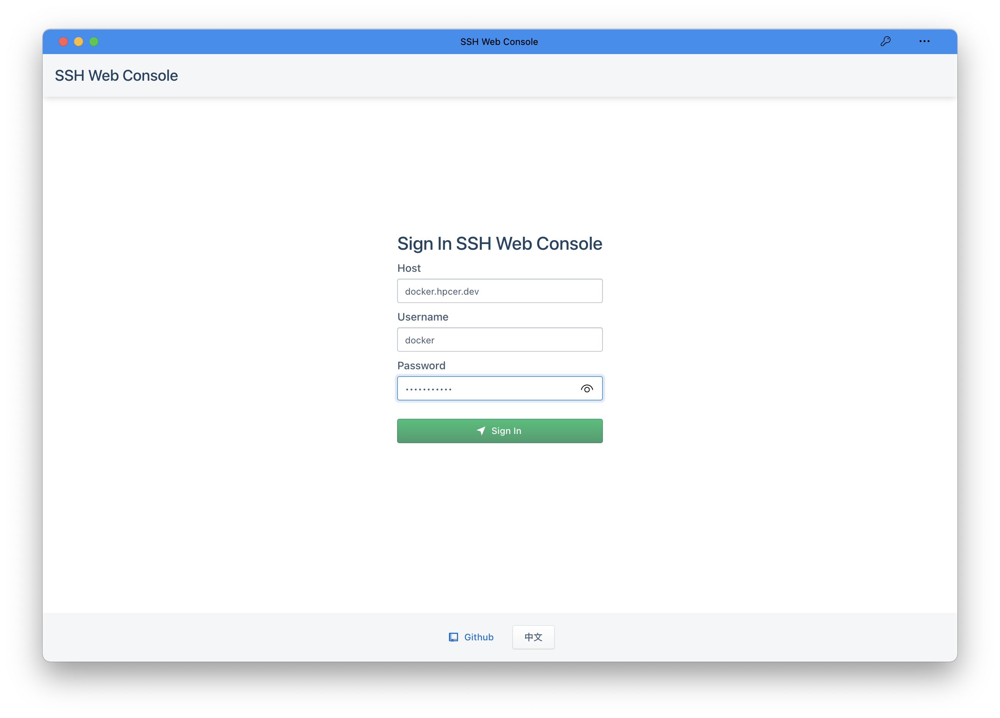
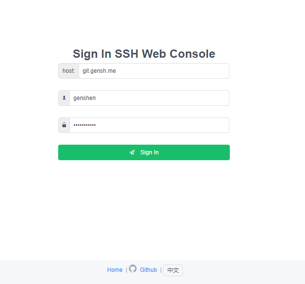
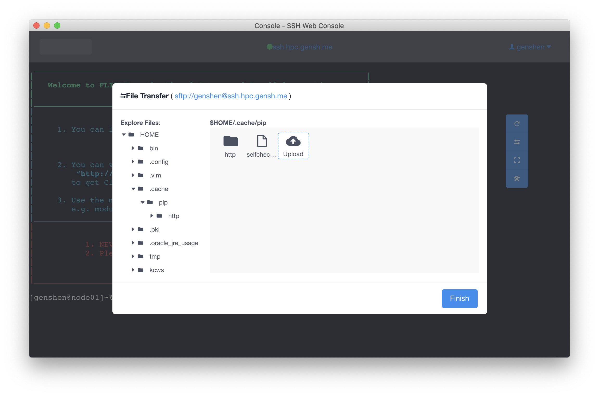

# ssh-web-console

you can connect to your linux machine by ssh in your browser.


## Quick start

```bash
$ docker pull genshen/ssh-web-console:latest
# docker build -t genshen/ssh-web-console . # or build docker image on your own machine
$ docker run -v ${PWD}/conf:/home/web/conf -p 2222:2222 --rm genshen/ssh-web-console
```

or using Docker Compose:

```bash
$ git clone https://github.com/genshen/ssh-web-console.git
$ cd ssh-web-console
$ docker-compose up -d
```

Open your browser, visit `http://localhost:2222`. Enjoy it!

**NOTE**: To run docker container, make sure config.yaml file is in directory ${PWD}/conf

## Build & Run

Make sure your Go version is 1.26 or later, and Node.js 16 for the frontend (react-scripts 4 does not build on Node >= 17)

### Clone

```bash
git clone --recurse-submodules https://github.com/genshen/ssh-web-console.git
cd ssh-web-console
```

### Build frontend

```bash
cd web
yarn install
yarn build
cd ../
```

### Build go

```bash
cp -r web/build build  # the frontend is embedded into the binary with go:embed (see main.go)
go build
```

## Run

run: `./ssh-web-console`, and than you can enjoy it in your browser by visiting `http://localhost:2222`.

## Screenshots





## Related Works

- [shibingli/webconsole](https://github.com/shibingli/webconsole)
